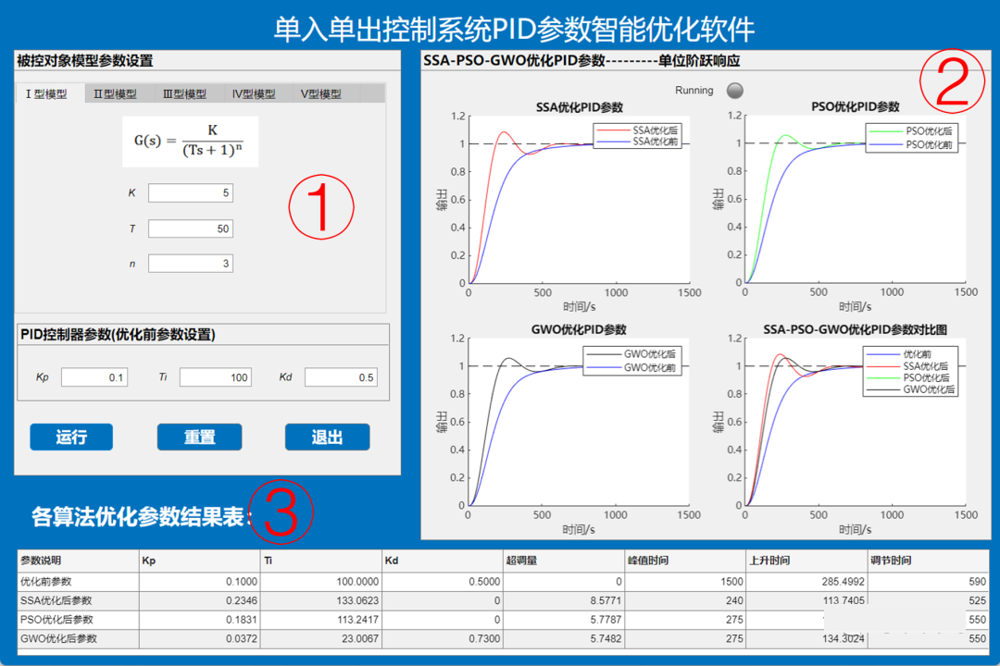
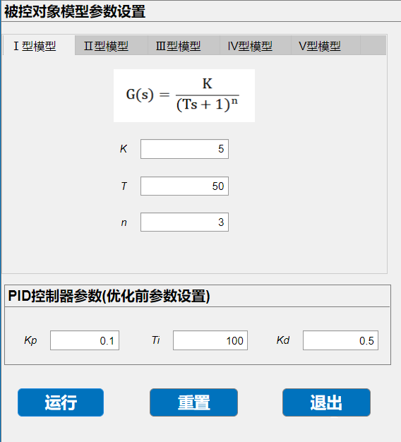
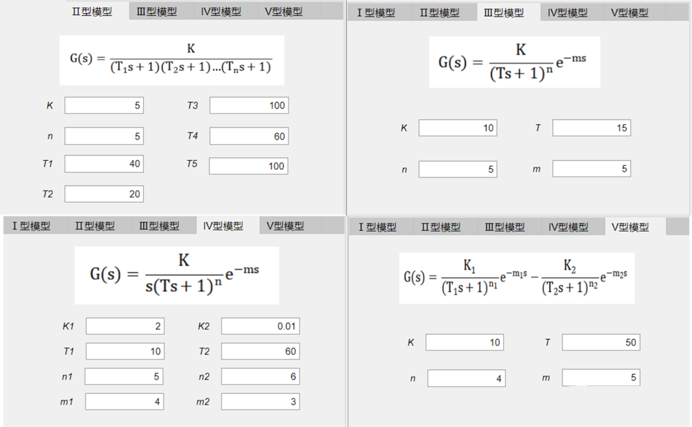
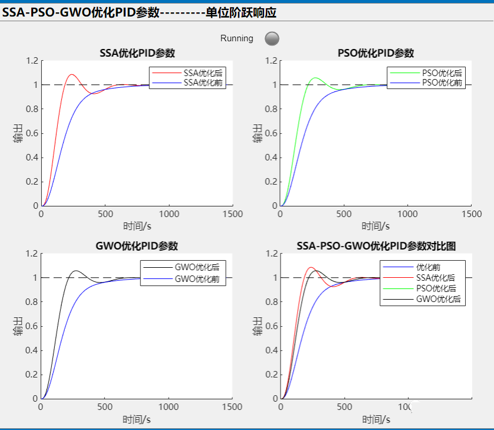
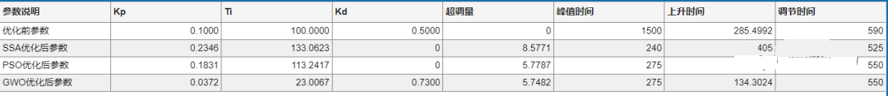

# Three Intelligent Algorithms Optimize PID Parameters Software, MATLAB App Development

This software basically covers all types of transfer functions. The parameters of the transfer function are simple and easy to modify. Three different algorithms are adopted to optimize PID parameters. Including the gray wolf. Particle swarm, Sparrow Algorithm And made a simple comparison. The results are also presented in a table format. Readily apparent.
The style of the painting is as follows:
\n        \n      Software is divided into three parts, and the following will elaborate on each part in detail:
Part One: Model Parameter Settings for the Object Under Suspect
\n        \n  
This section includes an option switch card, which allows you to switch between different transfer functions. These are the most common types of transfer functions, covering virtually all possible configurations.
\n        \n      Additionally, before clicking to start the operation, it is advisable to manually set a P, I, D parameter, which corresponds to Kp, Ti, Kd here. After setting them, click the "Run" button to begin optimizing the P, I, D parameters using the three optimization algorithms.
Click the reset button to reset all previously set parameters back to zero.
Part Two: SSA-PSO-GWO Optimization of PID Parameters - Unit Step Response
This section displays the optimization results of the three algorithms, namely the Sparrow Algorithm, Particle Swarm Optimization (PSO), and Grey Wolf Optimization (GWO). The final figure is a composite graph of the three curves.
A running indicator has been added here. When the system is running, the indicator will turn green; when it's finished running, the indicator will turn gray.
\n        \n  
Here, we discuss the objective functions adopted by three intelligent algorithms: selection of commonly used ITAE indicators and weighted control actions. The objective function is also very convenient to modify.
Part Three: After optimization of the three algorithms, the parameter table of the step response curve.
The parameter table is presented in a clear and concise manner. The parameters include: P, I, D parameters, overshoot, peak time, rise time, and settling time.
\n        \n      Code:
% Type I\n            %if flag~=2 && flag~=3 && flag~=3 && flag~=4 && flag~=5\n            if flag==1\n                K=app.KEditField.Value;\n                assignin("base",'K',K)\n                T=app.TEditField.Value;\n                assignin("base",'T',T)\n                n=app.nEditField.Value;\n                assignin("base",'n',n)\n                PI_1\n            end\n            % Type II\n            if flag==2\n                K=app.KEditField_2.Value;\n                assignin("base",'K',K)\n                Tz=[app.T1EditField.Value app.T2EditField.Value app.T3EditField.Value app.T4EditField.Value app.T5EditField.Value];\n                assignin("base",'Tz',Tz)\n                n=app.nEditField_2.Value;\n                assignin("base",'n',n)\n                PI_2\n            end\n            % Type III\n            if flag==3\n                K=app.KEditField_3.Value;\n                assignin("base",'K',K)\n                T=app.TEditField_2.Value;\n                assignin("base",'T',T)\n                n=app.nEditField_3.Value;\n                assignin("base",'n',n)\n                tt=app.mEditField_2.Value;\n                assignin("base",'tt',tt)\n                PI_3\n            end\n            % Type IV\n            if flag==4\n                K1=app.K1EditField.Value;\n                assignin("base",'K1',K1)\n                T1=app.T1EditField_2.Value;\n                assignin("base",'T1',T1)\n                n1=app.n1EditField.Value;\n                assignin("base",'n1',n1)\n                tt1=app.m1EditField.Value;\n                assignin("base",'tt1',tt1)\n\n                K2=app.K2EditField.Value;\n                assignin("base",'K2',K2)\n                T2=app.T2EditField_2.Value;\n                assignin("base",'T2',T2)\n                n2=app.n2EditField.Value;\n                assignin("base",'n2',n2)\n                tt2=app.m2EditField.Value;\n                assignin("base",'tt2',tt2)\n                PI_4\n            end\n            %V-shaped\n            if flag==5\n                K=app.KEditField_4.Value;\n                assignin("base",'K',K)\n                T=app.TEditField_3.Value;\n                assignin("base",'T',T)\n                n=app.nEditField_4.Value;\n                assignin("base",'n',n)\n                tt=app.mEditField.Value;\n                assignin("base",'tt',tt)\n                PI_5\n            end\n  

## Images

<!-- PAYMENT_BLOCK -->

## Get this dataset

- Payment link (Stripe): [Buy now](https://buy.stripe.com/3cs8yP7sY87d0vu9AB)
- Payment QR code: 

<!-- /PAYMENT_BLOCK -->
